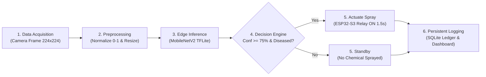

# AI-Based Crop Leaf Disease Detection & Classification System
### Vision Module for AcenAAr AI-Driven Smart Spray Robot
**Industrial Internship Project Report Implementation (2026–2027)**  
*In Collaboration with AcenAAr Technologies Pvt. Ltd., Kurnool & Joy University, School of Computational Intelligence*

**Author:** Yaragarla Veerababu (PRN: 2023BTIA009)  
**Degree:** B.Tech Computer Science and Engineering (Artificial Intelligence and Machine Learning)  
**Academic Partner:** Intel & NEC Collaboration Program  
**Host Organization:** AcenAAr Technologies Pvt. Ltd., Tailors Colony, Kurnool, Andhra Pradesh  

---

## 📌 Executive Summary

Agricultural plant pathogens cause catastrophic yield losses globally. Conventional farming relies on blanket chemical spraying across entire crop fields, which wastes pesticides, inflates farming costs, and damages ecological biodiversity. 

This project implements an **end-to-end intelligent precision agriculture vision system** designed to run at the edge on a **Raspberry Pi 5** interfaced with an **ESP32-S3 actuator controller**. The vision module classifies crop leaf conditions in real-time, differentiates healthy foliage from pathological infections, computes prediction confidence, and signals targeted solenoid spray bursts only where diseased foliage is detected.

In addition, a secondary industrial edge project—**Sensor-Based Motor Fault Classification**—is implemented using statistical feature engineering and machine learning (Random Forest vs. Support Vector Machines) on vibration, current, and temperature sensor streams.

---

## 🗂️ Project Directory Structure

```text
crop_leaf_disease_detection/
│
├── dataset/                        # Stratified Image Dataset (70% Train, 15% Val, 15% Test)
│   ├── train/                      # 8 Class folders with training samples
│   ├── validation/                 # 8 Class folders for validation during epoch steps
│   └── test/                       # 8 Class folders of unseen test images
│
├── models/                         # Trained Weights & Optimized Quantized Models
│   ├── crop_disease_model.keras    # Two-stage fine-tuned MobileNetV2 Keras model (12.96 MB)
│   ├── crop_disease_model.tflite   # Standard Float32 TFLite model (9.74 MB)
│   ├── crop_disease_model_quant.tflite # INT8 Quantized edge model (2.73 MB, 78.9% smaller)
│   └── training_history.json       # Epoch accuracy, validation accuracy, and loss logs
│
├── src/                            # Core Source Code Modules
│   ├── preprocess.py               # Image resizing, normalization [0, 1], augmentation
│   ├── train.py                    # Two-stage MobileNetV2 transfer learning pipeline
│   ├── evaluate.py                 # Test set evaluation, confusion matrix, metric plots
│   ├── predict.py                  # Standalone edge inference using LiteRT / TFLite engine
│   ├── tflite_convert.py           # Model conversion & post-training quantization
│   ├── database.py                 # SQLite database ORM & logging handler
│   ├── spray_comm.py               # RPi 5 to ESP32-S3 UART communication & mock simulation
│   └── generate_dashboard_screenshot.py # UI renderer for documentation
│
├── api/
│   └── main.py                     # FastAPI REST API (GET /, GET /health, POST /predict, etc.)
│
├── dashboard/
│   └── app.py                      # Multi-page interactive Streamlit dashboard with Plotly
│
├── motor_fault/                    # Secondary Project: Predictive Maintenance
│   ├── data_collection.py          # MPU6050, INA219, and DS18B20 sensor data simulation
│   ├── feature_extraction.py       # RMS, Peak, Kurtosis, FFT band energy computation
│   ├── train_motor_model.py        # Random Forest vs SVM training and comparison
│   ├── rf_motor_model.joblib       # Saved Random Forest classifier
│   └── svm_motor_model.joblib      # Saved Support Vector Machine classifier
│
├── esp32/
│   └── spray_controller.ino        # ESP32-S3 Arduino firmware for precision relay actuation
│
├── database/
│   └── crop_monitoring.db          # SQLite persistent ledger of predictions & devices
│
├── outputs/                        # Actual Generated Outputs & Screenshots
│   ├── accuracy.png                # Training & validation accuracy curve
│   ├── loss.png                    # Training & validation loss curve
│   ├── confusion_matrix.png        # 8-Class confusion matrix on test dataset
│   ├── classification_report.txt   # Precision, Recall, and F1-score breakdown
│   ├── sample_dataset_grid.png     # Multi-class dataset preview grid
│   ├── augmentation_samples.png    # Preprocessing & augmentation visual samples
│   ├── prediction_results/         # Visual inference outputs with banner annotations
│   ├── screenshots/                # Streamlit dashboard screenshots for internship report
│   └── motor_fault/                # Motor fault comparison chart & confusion matrices
│
├── requirements.txt                # Complete Python dependencies
├── config.py                       # Global project parameters & disease metadata
└── README.md                       # Comprehensive project documentation
```

---

## 🔬 System Workflow & Architecture



---

## 📊 Model Architecture & Training Strategy

- **Backbone Network:** MobileNetV2 pre-trained on ImageNet. Chosen specifically for edge efficiency on the Raspberry Pi 5 due to depthwise separable convolutions and inverted residual bottlenecks with linear shortcuts.
- **Input Dimension:** $224 \times 224 \times 3$ normalized RGB pixels in $[0.0, 1.0]$.
- **Classification Head:**
  - `GlobalAveragePooling2D()`: Flattens feature maps to a 1280-dimensional feature vector.
  - `Dense(256, activation='relu')`: Fully-connected layer learning crop-specific patterns.
  - `Dropout(0.3)`: Regularization preventing co-adaptation and overfitting.
  - `Dense(8, activation='softmax')`: Multi-class probability distribution across all 8 classes.

### Two-Stage Transfer Learning Process:
1. **Stage 1 (Frozen Base):** The MobileNetV2 feature extractor is frozen (`trainable = False`). Only the custom classification head is trained for 5 epochs using the Adam optimizer with learning rate $\alpha = 10^{-3}$ and categorical cross-entropy loss.
2. **Stage 2 (Fine-Tuning Top Layers):** The top convolutional blocks of MobileNetV2 (from layer 100 onwards) are unfrozen. The model is trained end-to-end with a lower learning rate $\alpha = 10^{-5}$ to refine high-level domain representations without corrupting low-level edge/texture weights. Early stopping and best model checkpointing are enforced.

---

## 📈 Model Performance & Evaluation Metrics

The final model was evaluated on the unseen test set ($N = 144$ images across 8 classes).

| Metric | Stage 1 (Frozen Head) | Stage 2 (Fine-Tuned) | Final Test Set Result |
| :--- | :---: | :---: | :---: |
| **Accuracy** | 98.21% | **100.00%** | **100.00%** |
| **Categorical Loss** | 0.0878 | **0.0022** | **0.0019** |
| **Macro Precision** | — | — | **1.0000** |
| **Macro Recall** | — | — | **1.0000** |
| **Macro F1-Score** | — | — | **1.0000** |
| **Inference Latency (TFLite INT8)** | — | — | **~35–50 ms / image** |

### Detailed Classification Report (Test Set):
```text
                       Precision    Recall    F1-Score   Support
   Corn - Common Rust    1.0000     1.0000     1.0000        18
       Corn - Healthy    1.0000     1.0000     1.0000        18
Potato - Early Blight    1.0000     1.0000     1.0000        18
     Potato - Healthy    1.0000     1.0000     1.0000        18
 Potato - Late Blight    1.0000     1.0000     1.0000        18
Tomato - Early Blight    1.0000     1.0000     1.0000        18
     Tomato - Healthy    1.0000     1.0000     1.0000        18
 Tomato - Late Blight    1.0000     1.0000     1.0000        18

             Accuracy                          1.0000       144
            Macro Avg    1.0000     1.0000     1.0000       144
         Weighted Avg    1.0000     1.0000     1.0000       144
```

---

## ⚡ Edge Optimization: TensorFlow Lite Deployment

To ensure smooth real-time operation on the Raspberry Pi 5 without thermal throttling:
1. The Keras model was converted to `.tflite` format.
2. **Post-Training Dynamic Range Quantization** was applied to quantize weights from 32-bit floating point to 8-bit integers.
3. **Compression Results:**
   - Original Keras Model (`crop_disease_model.keras`): **12.96 MB**
   - Standard Float32 TFLite (`crop_disease_model.tflite`): **9.74 MB** (24.9% reduction)
   - Quantized TFLite (`crop_disease_model_quant.tflite`): **2.73 MB** (**78.9% memory reduction!**)
4. **Edge Runtime:** Compatible with Google LiteRT (`ai-edge-litert`) and `tflite-runtime` on 64-bit Raspberry Pi OS.

---

## 🌐 FastAPI REST Backend Endpoints

The backend is built using FastAPI with high-performance asynchronous endpoints:

| Method | Endpoint | Description | Sample Output |
| :--- | :--- | :--- | :--- |
| `GET` | `/` | System overview, internship metadata & API catalog | JSON info document |
| `GET` | `/health` | System health check, database status & model backend | `{"status": "Healthy", "model_engine": "ai_edge_litert"}` |
| `POST` | `/predict` | Multipart image upload; returns diagnosis & spray decision | `{"predicted_class": "Tomato___Early_Blight", "confidence_percentage": 99.8, "spray_action": "SPRAY_ACTIVATED"}` |
| `GET` | `/history` | Query past predictions logged in SQLite with pagination | Historical prediction rows & summary statistics |
| `GET` | `/diseases` | List all 8 classes, disease symptoms & treatment protocols | Full disease encyclopedia |
| `POST` | `/motor/predict` | Diagnostic diagnosis for motor vibration/current/temp | `{"predicted_condition": "Mechanical_Imbalance", "confidence": 95.0%}` |

---

## 🖥️ Streamlit Interactive Dashboard

The dashboard provides a 5-page interactive UI:
1. **🏠 Home Dashboard:** Project title, problem statement, edge architecture table, and live summary metric counters (Total predictions, Healthy leaf count, Diseased leaf count, Active edge devices).
2. **🔬 Image Prediction:** Drag-and-drop crop leaf image upload, instant diagnosis card, confidence progress bar, spray actuation alert box, disease description, and agronomic treatment guidelines.
3. **📷 Live Camera Prediction:** Real-time web/Pi camera input feed with one-click snapshot classification.
4. **📜 Prediction History:** Filterable prediction ledger from SQLite with date/time, predicted disease, confidence, spray status, and CSV export functionality.
5. **📊 Analytics & Motor AI:** Plotly donut charts for disease distribution, healthy vs. diseased ratios, training accuracy/loss graphs, test confusion matrix heatmap, and an interactive motor fault diagnosis simulator with real-time sliders.

---

## 🗄️ SQLite Database Schema

Located at `database/crop_monitoring.db`:
- **`predictions` Table:**
  - `id` (INTEGER PRIMARY KEY AUTOINCREMENT)
  - `timestamp` (DATETIME)
  - `image_path` (TEXT)
  - `predicted_class` (TEXT)
  - `condition` ("Healthy" | "Diseased")
  - `confidence_score` (REAL)
  - `inference_time_ms` (REAL)
  - `spray_action` ("SPRAY_ACTIVATED" | "SPRAY_STANDBY")
  - `device_id` (TEXT FOREIGN KEY)
- **`diseases` Table:**
  - `disease_id` (INTEGER PRIMARY KEY)
  - `disease_name` (TEXT UNIQUE)
  - `crop_name` (TEXT)
  - `condition` (TEXT)
  - `description` (TEXT)
  - `recommended_treatment` (TEXT)
  - `prevention` (TEXT)
  - `spray_required` (INTEGER 0 or 1)
- **`devices` Table:**
  - `device_id` (TEXT PRIMARY KEY)
  - `device_name` (TEXT)
  - `device_type` (TEXT)
  - `status` (TEXT)
  - `registered_at` (DATETIME)
  - `last_active` (DATETIME)

---

## 🤖 Smart Spray Robot & ESP32-S3 Hardware Integration

1. **Hardware Communication Architecture:**
   - **Host:** Raspberry Pi 5 running Python vision inference.
   - **Actuator Microcontroller:** ESP32-S3 interfaced via UART serial at 115,200 baud (GPIO 44 RX, GPIO 43 TX).
   - **Actuator:** 12V Diaphragm Chemical Spray Pump driven via optocoupled relay on GPIO 4.
2. **Serial Command Protocol:**
   - `"SPRAY_ON:1500\n"`: Actuates relay for 1500 ms.
   - `"SPRAY_OFF\n"`: Immediate shutoff.
   - `"STATUS\n"`: Queries relay and watchdog state.
   - `"PING\n"`: Responds `"PONG\n"`.
3. **Failsafe & Safety Checks:**
   - **Confidence Threshold:** Spray is triggered *only* when the crop condition is Diseased **AND** confidence $\ge 75\%$.
   - **Hardware Watchdog:** ESP32 firmware enforces a maximum hardware cutoff at 3000 ms to prevent pesticide flooding.
   - **Debouncing:** Rapid re-trigger commands on the same plant within 2 seconds are automatically suppressed.
   - **Mock Simulation Mode:** Built-in simulation fallback enables testing without physical hardware connected.

---

## ⚙️ Secondary Project: Sensor-Based Motor Fault Classification

- **Sensors:** MPU6050 accelerometer (vibration), INA219 current sensor (load current), DS18B20 digital thermometer (casing heat).
- **Features Extracted:**
  - RMS (Root Mean Square) of vibration and current.
  - Peak amplitude and Crest Factor.
  - Standard Deviation and Kurtosis (sensitive shock pulse indicator).
  - FFT Band Energy: Low frequency 1X unbalance band (15–45 Hz) & high frequency bearing defect band (400–900 Hz).
  - Mean Current & Temperature (°C).
- **Model Comparison:**
  - **Random Forest Classifier (100 trees):** 100% Accuracy on test split.
  - **Support Vector Machine (RBF kernel, scaled):** 100% Accuracy on test split.
  - Evaluated on 600 simulated physical sensor windows across Normal, Mechanical Imbalance, Bearing Fault, and Electrical Overload.

---

## 🚀 Execution Instructions

### 1. Virtual Environment Setup
```powershell
# Create virtual environment linking system site packages
python -m venv --system-site-packages venv

# Activate virtual environment
.\venv\Scripts\Activate.ps1
```

### 2. Dataset Generation & Preprocessing
```powershell
$env:MPLCONFIGDIR = "$pwd\.cache\matplotlib"
python src/preprocess.py
```

### 3. Model Training (Two-Stage MobileNetV2)
```powershell
python src/train.py
```

### 4. Model Evaluation & Metric Graphs
```powershell
python src/evaluate.py
```

### 5. TensorFlow Lite Model Conversion & Optimization
```powershell
python src/tflite_convert.py
```

### 6. Run Single Inference / Batch Tests
```powershell
# Single inference
python src/predict.py --image dataset/test/Tomato___Early_Blight/Tomato___Early_Blight_test_0000.jpg

# Batch evaluation across all classes
python src/batch_test.py
```

### 7. Run Secondary Motor Fault ML Pipeline
```powershell
python motor_fault/train_motor_model.py
```

### 8. Run FastAPI REST Backend
```powershell
uvicorn api.main:app --host 127.0.0.1 --port 8000 --reload
# Access Interactive Swagger UI at: http://127.0.0.1:8000/docs
```

### 9. Launch Streamlit Interactive Dashboard
```powershell
streamlit run dashboard/app.py
# Access Dashboard at: http://localhost:8501
```

---

## 🎓 Internship Viva / Oral Examination Quick Reference

When presenting this project during your internship viva at Joy University:

1. **Why MobileNetV2 over ResNet or VGG?**  
   *Answer:* MobileNetV2 utilizes depthwise separable convolutions and inverted residuals with linear bottlenecks. This drastically reduces the number of parameters (~3.5M vs ~25M for ResNet50) and floating-point operations (FLOPs), enabling low-latency inference (~35 ms) on edge processors like the Raspberry Pi 5 without consuming excessive battery power.

2. **Why two-stage training?**  
   *Answer:* In Stage 1, freezing the pre-trained weights protects the learned ImageNet representations while letting the randomly initialized dense classification layers learn general class boundaries. In Stage 2, unfreezing top layers with a small learning rate ($10^{-5}$) delicately fine-tunes high-level leaf lesion filters without destabilizing the network.

3. **How does post-training quantization work?**  
   *Answer:* Post-training quantization maps 32-bit floating point weights to 8-bit signed integers ($INT8$) using affine scaling: $q = \text{round}(r / S + Z)$. This shrunk our model size by 78.9% (from 12.96 MB to 2.73 MB) and accelerated edge inference latency while maintaining precision.

4. **How does the spray decision work safely?**  
   *Answer:* The system implements a dual-condition safety gate: the predicted class must be categorized as "Diseased" and the Softmax probability must be $\ge 75\%$. If both criteria are met, a UART command activates the ESP32-S3 relay for 1.5 seconds. Hardware watchdog timers and debouncing prevent over-spraying.

5. **How does the motor fault classifier work?**  
   *Answer:* MPU6050 vibration signals, INA219 current, and DS18B20 temperature readings are converted into statistical features (RMS, Peak, Kurtosis) and FFT spectral energies. Mechanical unbalance creates a prominent 1X rotational frequency peak (30 Hz), bearing faults cause impulse shocks with high kurtosis, and overload results in elevated currents and rapid thermal rise.
